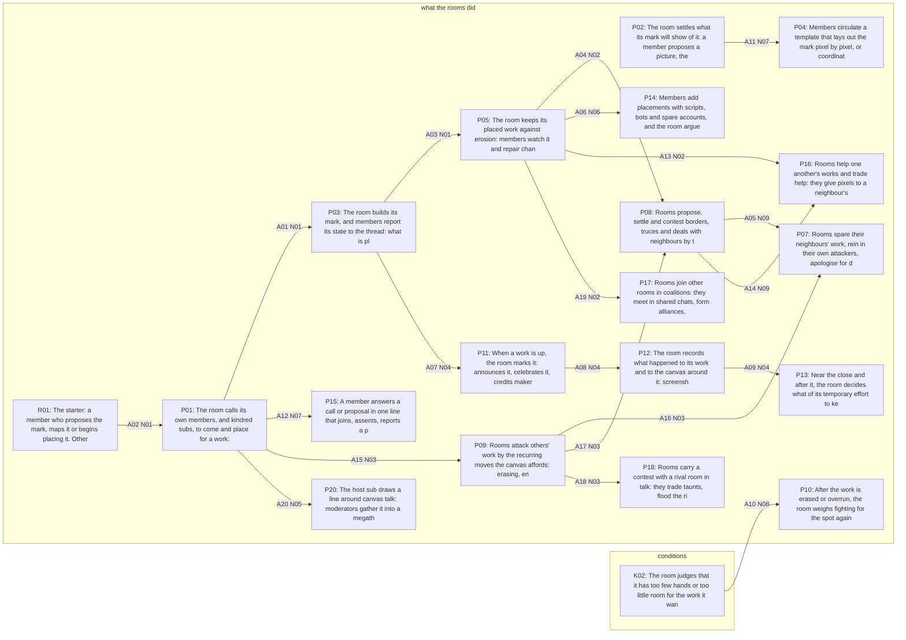

# The model, drawn from model/
# generated by gen_views.py; sources: elements.jsonl 798a87bdd68dee10; arrows.jsonl ff0b39638fbaa826; propositions.jsonl f759f4564136946d

## With the theorised arrows (20)

## Without the theorised arrows (20)

